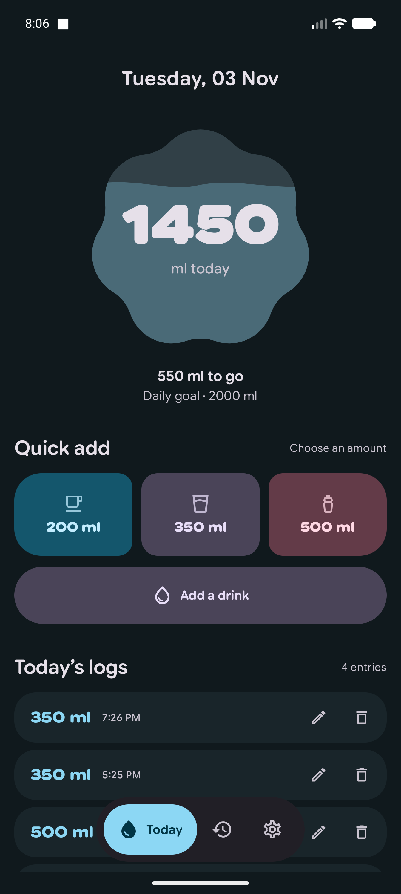
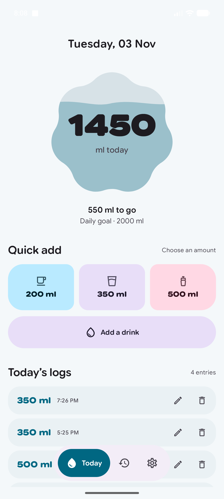
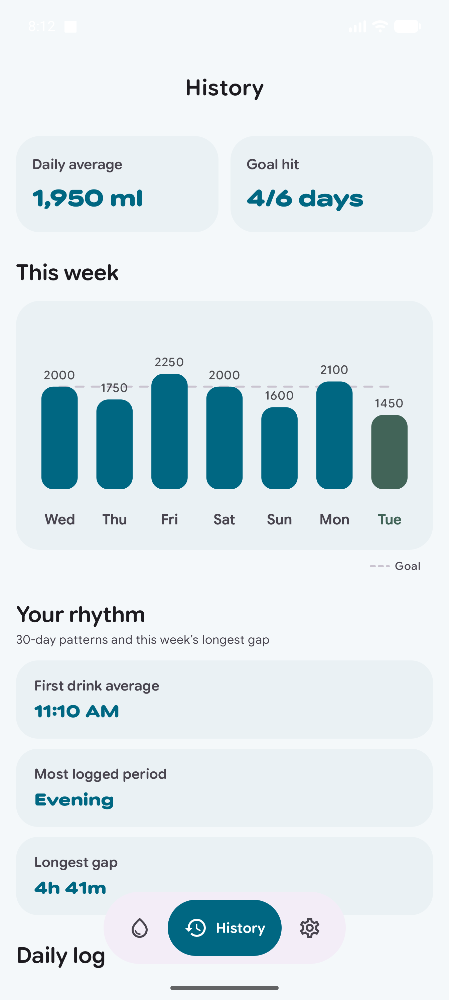
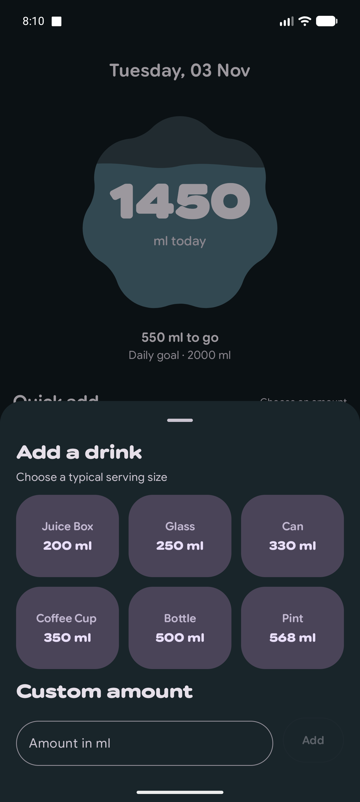
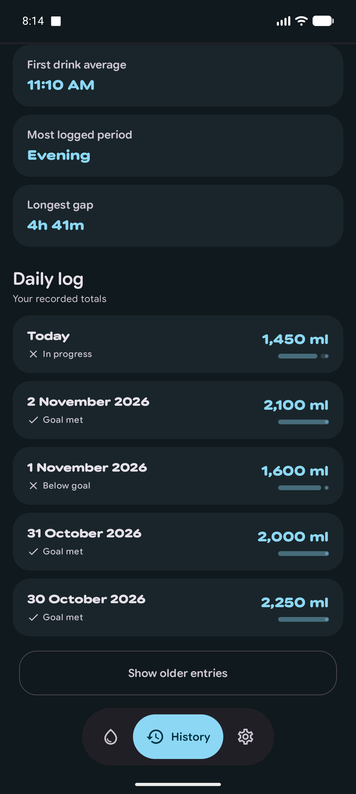
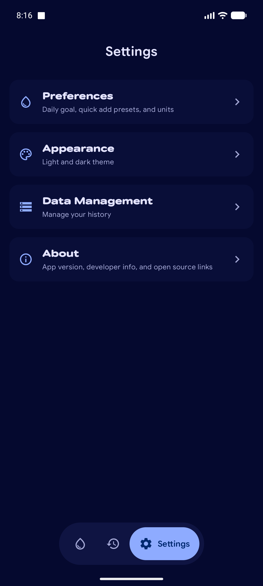
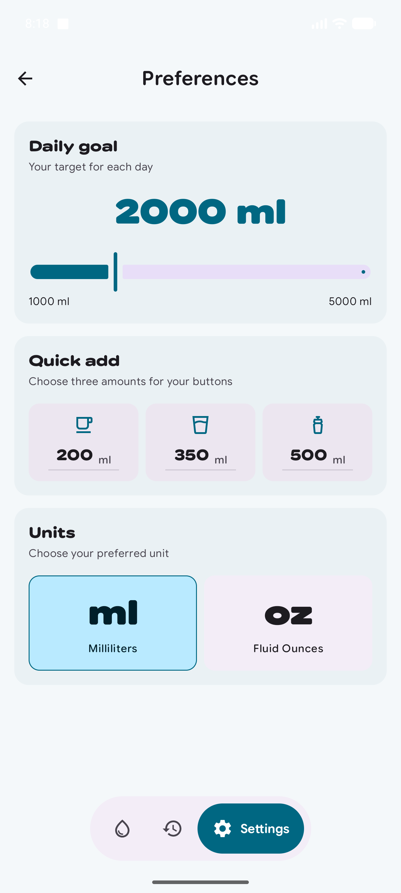
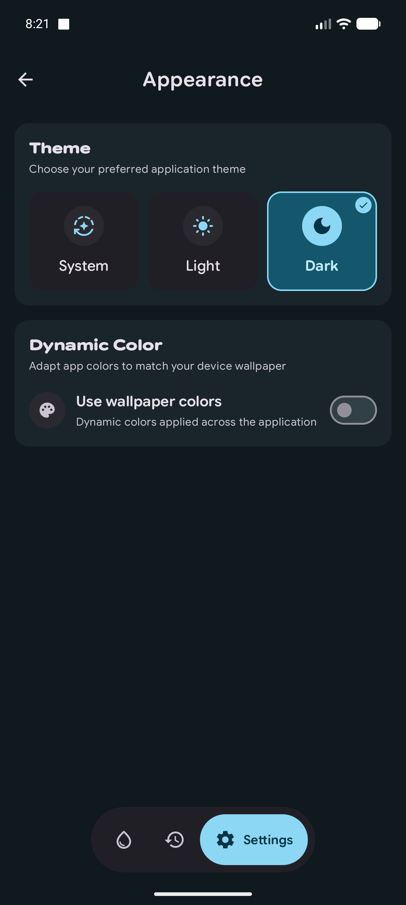
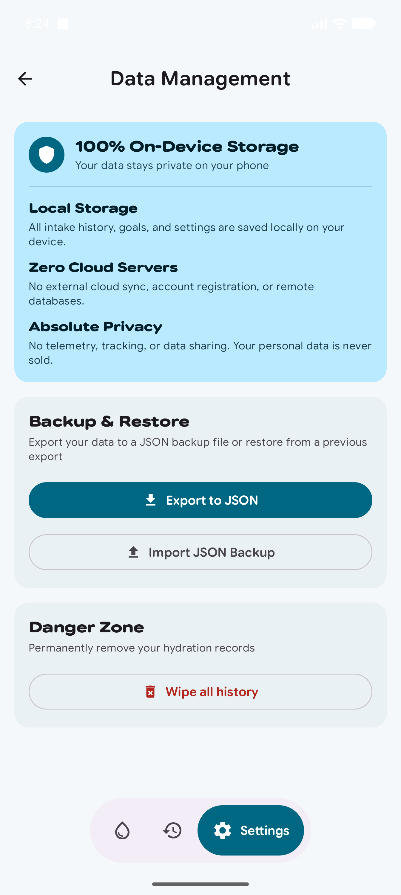
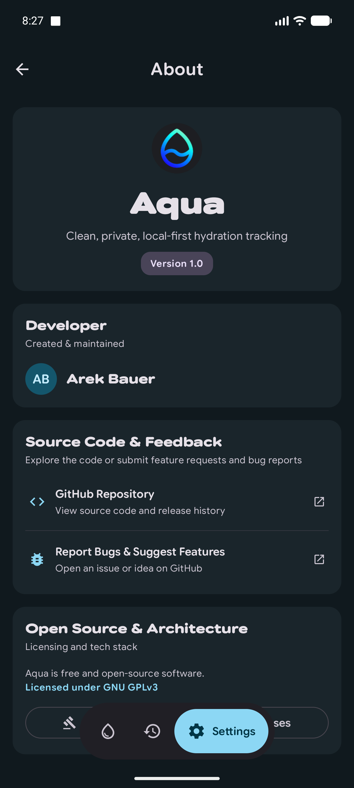

# Aqua 💧

**Aqua** is a clean, modern, private, and local-first hydration tracking app for Android built using Jetpack Compose, Material 3 Expressive UI, Hilt, and Room.

---

## 📱 Screenshots

| Today Screen (Dark) | Today Screen (Light) | History & Insights |
| :---: | :---: | :---: |
|  |  |  |

<b>🔍 View Additional Screenshots (Serving Picker, Settings, Data & Privacy, Theme)</b>

 

| Serving Picker | Daily Log History | Settings Main |
| :---: | :---: | :---: |
|  |  |  |

| Preferences | Appearance | Data Management | About |
| :---: | :---: | :---: | :---: |
|  |  |  |  |

---

## ✨ Features

- 💧 **Daily Hydration Tracker**: Log water intake with customizable quick-add presets or serving picker.
- 📊 **30-Day Insights & Trends**: View weekly intake charts, daily completion statuses, first drink averages, and activity patterns.
- 🎨 **Material 3 Expressive UI**: Dynamic wallpaper themes, dark/light mode toggle, and animated reservoir progress gauge.
- 🛡️ **100% On-Device Privacy**: No accounts, no cloud servers, no telemetry, and no data tracking.
- 💾 **JSON Backup & Restore**: Full local export and import capabilities to back up or migrate your records anytime.

---

## 📚 Documentation & Guides

- 🏗️ **[Architecture & Tech Stack](docs/architecture.md)**: Clean Architecture overview, layer breakdown, and Mermaid data flow diagrams.
- 🧪 **[Testing Strategy](docs/testing.md)**: JVM unit tests, instrumented Compose & Room tests, and JaCoCo coverage reports.
- 🤝 **[Contributing Guidelines](CONTRIBUTING.md)**: Guidelines for opening issues, PR workflow, and code conventions.
- 🛡️ **[Security & Privacy Policy](SECURITY.md)**: Local-first privacy guarantees and responsible vulnerability disclosure.
- 🚀 **[Future Roadmap](docs/future.md)**: Upcoming features including Home Screen Widgets and Wear OS support.

---

## 📄 License

Aqua is free and open-source software licensed under the [GNU General Public License v3.0](LICENSE).
