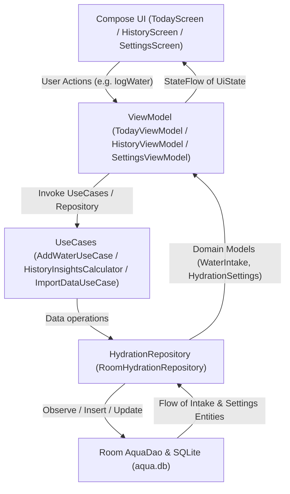
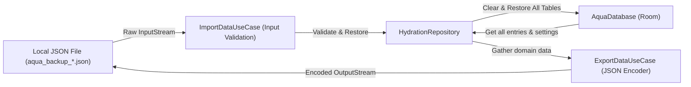

# Tech Stack & Architecture

Aqua is designed following modern Android architecture guidelines (Clean Architecture + Unidirectional Data Flow with MVI/MVVM).

---

## 🛠️ Tech Stack

- **Language**: Kotlin 2.x
- **UI Framework**: Jetpack Compose with Material 3 Expressive UI (`androidx.compose.material3`)
- **Navigation**: Jetpack Navigation 3 (`androidx.navigation3`)
- **Dependency Injection**: Hilt (`com.google.dagger:hilt-android`)
- **Database & Persistence**: Room (`androidx.room`) with schema exports and versioned migrations
- **Serialization**: Kotlinx Serialization (`kotlinx-serialization-json`)
- **Testing**: JUnit 4, Compose UI Testing, Room Migration Testing, and JaCoCo coverage reports

---

## 🏗️ Architecture Overview

The codebase is organized into distinct layers to enforce separation of concerns and testability:

```
app/src/main/java/com/arekb/aqua/
 ├── data/            # Room database, Entities, DAOs, Migrations, and Repository implementations
 ├── di/              # Hilt Modules (DatabaseModule, HydrationRepositoryModule, UseCaseModule)
 ├── domain/          # Data Models, Repository interfaces, UseCases, and Insights Calculator
 └── ui/              # Navigation, Screens (Today, History, Settings), Components, and Theme
```

### Unidirectional Data Flow (UDF) Diagram



---

## 💾 Local Backup & Restore Pipeline



---

## 🔑 Key Architectural Principles

1. **Unidirectional Data Flow (UDF)**: ViewModels expose reactive state via `StateFlow` collected with `collectAsStateWithLifecycle()` in Compose.
2. **Injectable Clock**: `java.time.Clock` is injected via Hilt across ViewModels and UseCases for deterministic date/time handling and testing.
3. **Database Schema Migrations**: Explicit Room migrations (`MIGRATION_1_2`, `MIGRATION_2_3`, `MIGRATION_3_4`) ensure seamless data upgrades without data loss.
4. **Data Validation & Privacy**: All local backup exports/imports use type-safe JSON serialization with input validation, keeping 100% of data on-device.
